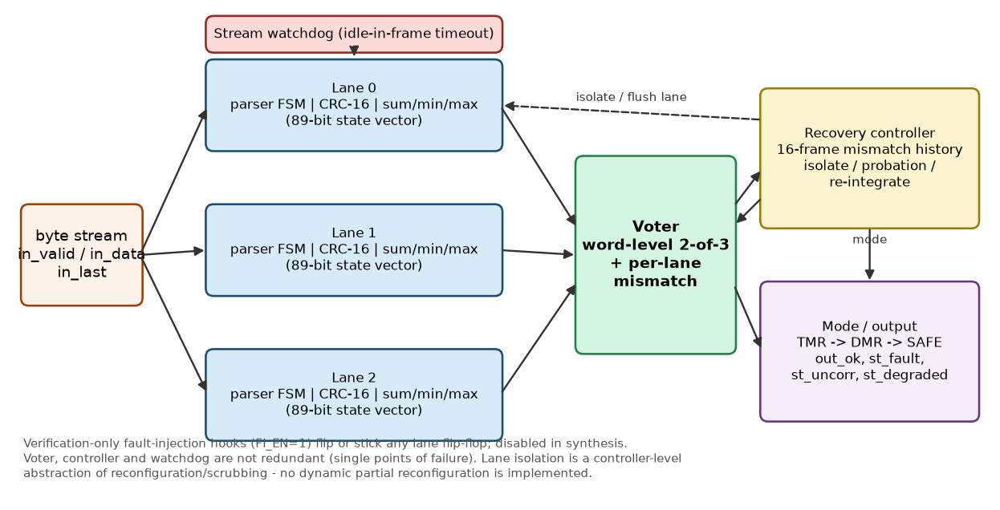
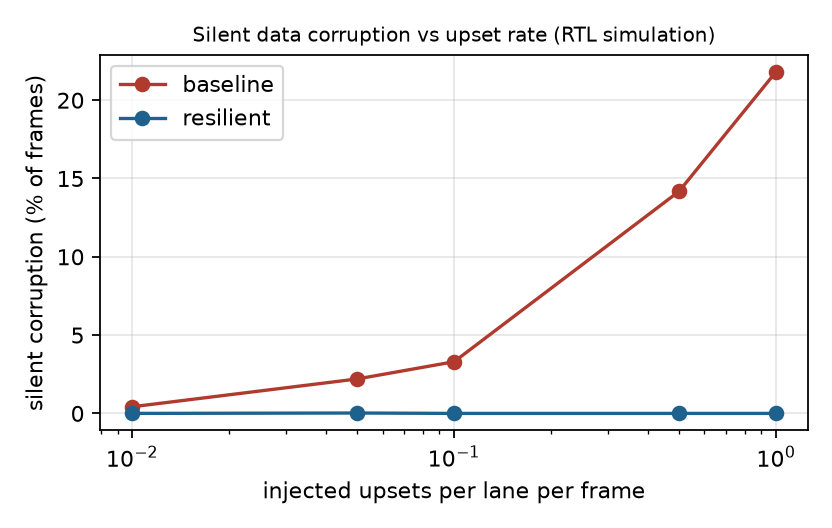

# leo-fpga-fault-tolerant-telemetry

Synthesizable Verilog **telemetry-frame processor** for a LEO satellite payload/OBC, in two versions that share one stream interface:

* **baseline** - one lane: frame parser, CRC-16 check, payload statistics (sum/min/max).
* **resilient** - three lanes (TMR) + word-level voter + recovery controller (lane isolation, shadow-lane probation, re-integration, TMR -> DMR -> SAFE degradation) + stream watchdog.

The point of the project is to *measure* what each mechanism buys and costs under injected flip-flop faults, not to claim radiation hardness.

> **Scope and honesty.** Everything here is RTL simulation (Icarus Verilog) and logic synthesis (Yosys). **No FPGA board was used, no vendor place-and-route or timing run was done, no radiation or beam testing was done.** Faults are injected by forcing flip-flops in simulation; this is a software fault model, not a physical one. **Dynamic partial reconfiguration is not implemented**: "lane isolation / lane flush" is a *controller-level abstraction* of what a scrubbing or reconfiguration flow would do. The voter, controller and watchdog are not redundant (single points of failure) and are not fault-injected.

## Architecture



Frame format (bytes): `A5 5A | TYPE | SEQ | LEN(1..32) | PAYLOAD | CRC16_HI | CRC16_LO` (CRC-16/CCITT-FALSE over TYPE..PAYLOAD); `in_last` marks the final byte (link-layer framing).
Output per frame: `ok, type, seq, sum, min, max` plus status flags `fault / uncorrectable / degraded`, isolation mask, watchdog event.

Design decisions and why (each one is exercised by a test or experiment below):

| Mechanism | Why it is there | Evidence |
|---|---|---|
| CRC-16 + length/sync validation | detect *link* corruption, reject malformed frames | directed T2/T3, every single-bit error in a frame detected (pytest) |
| Coarse-grained TMR (3 identical lanes) | one flipped flop in the parser/CRC/statistics datapath is outvoted; the whole lane is protected, not just selected registers | T4, E1 |
| **Word-level** 2-of-3 vote (deliver only if two lanes agree on all 49 result bits) | an earlier *bitwise* vote "repaired" coincident double faults into plausible wrong values (8 silent corruptions in a 4000-frame run at lambda=0.1); requiring an identical pair turns them into detected rejects | design-iteration note below, T4f |
| Bitwise-majority *diagnosis* only for blame | localises the faulty lane even when two lanes are faulty | T7 (SAFE-mode attribution) |
| Mismatch history (16 frames) -> isolate at >=6 | separates persistent faults (stuck-at) from isolated upsets; the first settings (3 of 8, then 4 of 16) mis-isolated healthy lanes at accelerated upset rates | T5, T8, E2 |
| DMR after isolation | with a known-bad lane excluded, a coincident fault in a healthy lane becomes *detected* instead of outvoting the good lane | T6, T10, E3 |
| Shadow-lane probation (8 clean frames) | transient bursts must not permanently cost redundancy; stuck-at lanes never pass probation | T8 |
| SAFE mode (1 healthy lane, output flagged `degraded`) | keeps data flowing, but tells the consumer it is unverified | T7 |
| Stream watchdog | upstream stall mid-frame would otherwise leave lanes mid-frame and lose the next frame | T9 (baseline loses the frame, resilient does not) |

## Verification

* `tb/tb_directed.v`: **33 self-checking checks** (valid/invalid frames, length limits, single upsets in each lane, double fault, stuck-at isolation, DMR fail-safe, SAFE mode, burst + re-integration, watchdog stall, same-bit persistent+transient fault with and without isolation, baseline-vs-resilient contrast, 2-cycle latency check).
* `scripts/mutation_check.py`: 8 deliberately broken RTL variants (voter, fault flag, no-agreeing-pair rejection, isolation, watchdog, CRC compare, LEN bound, DMR reject); **all 8 are caught** by the directed suite (`results/mutation_check.md`). Two mutants initially *survived*; the tests were strengthened until they were killed.
* `scripts/campaign.py`: randomized fault-injection campaigns, scored per frame against an independent specification-level Python golden model (`model/tlm_model.py`).
* Functional-coverage bookkeeping: FSM states visited per lane (8 of 9 in a clean random run; the 9th, `S_DROP`, is entered only by invalid-LEN frames, covered by directed test T3 but not counted in the campaign bookkeeping), isolation masks observed (TMR/DMR/SAFE), fault classes (single/multi-bit upsets per state-vector region, stuck-at in any of the 89 state bits).
* `tests/test_project.py`: 9 pytest tests (CRC check value, golden-model rules, RTL/model layout agreement, directed TB, clean-stream equivalence, sparse-upset invariants).

## Results (campaign, `results/campaign_results.md`)

Fault model: single-bit flips (10 % adjacent double-bit) in the 89-bit lane state vector at rate lambda per lane per frame, same per-bit rate for both designs (so the resilient design receives 3x as many upsets in total). SDC = frame delivered with `ok=1` but data different from the golden model. 2 seeds x 2000 frames per row.

| lambda | design | unflagged SDC (% of delivered) | detection coverage of activated faults | frames lost (false drops) |
|---|---|---|---|---|
| 0.01 | baseline | 17 (0.45 %) | none (no detector) | 13 |
| 0.01 | resilient | **0** | 100 % (78/78) | 0 |
| 0.05 | baseline | 88 (2.34 %) | none | 61 |
| 0.05 | resilient | 1 (0.03 %) | 100 % (415/415) | 21 |
| 0.1 | baseline | 132 (3.56 %) | none | 111 |
| 0.1 | resilient | **0** | 99.4 % (693/697) | 73 |
| 0.5 | resilient | 0 unflagged, 518 flagged `degraded` | 8 % (lanes retired -> SAFE mode, no redundancy left) | 646 |

* Detection latency (injection -> fault flag at the output): median 13-14 cycles, max 43. Lane resynchronisation (injection -> next fully clean frame): median ~40 cycles (the next frame boundary).
* Persistent stuck-at (E2: random bit/lane/value, a second persistent fault in another lane mid-run, background upsets): baseline delivers silently wrong data in **56 %** of frames (one stuck bit); resilient delivers **0 unflagged** wrong frames, isolates the stuck lane after a median of 5.5 frames (max 37) in 30/30 trials, and runs in DMR/SAFE afterwards. Cost while two lanes are permanently faulty: ~10 % of frames rejected (3752/36000) and ~41 % of frames delivered in flagged, unverified SAFE mode (14664/36000).
* Same-bit persistent + transient fault (E3): without isolation 7.1 % silent corruption; with isolation 0.04 %, with 2542 frames rejected instead of corrupted.
* **At very high upset rates (lambda >= 0.5, > 1 upset per frame across lanes) the design retires lanes and degrades into flagged SAFE mode; coverage numbers there reflect the absence of redundancy, not a working detector.** This regime is far beyond realistic LEO upset rates and is reported only to show the failure behaviour.



### Cost (`results/synth_stats.md`; Yosys `synth_xilinx -family xc7`, fault hooks disabled)

| design | LUTs | FFs | CARRY4 |
|---|---|---|---|
| baseline | 118 | 140 | 8 |
| resilient | 1015 | 410 | 42 |
| overhead | x8.6 | x2.9 | x5.3 |

Throughput is unchanged (1 byte/cycle accepted by both, `in_last` -> `out_valid` latency 2 cycles for both, asserted in the directed test). **Timing/Fmax was not evaluated** (no place-and-route), so a frequency penalty from the voter path is possible and unmeasured. The controller (history popcounts, comparators) dominates the LUT overhead; it was not optimised.

### Design iteration (kept because it explains the final design)
1. First version: bitwise majority vote, isolate at 3 mismatches/8 frames. Campaign showed (a) healthy lanes isolated by ordinary upset bursts, (b) SAFE mode could never exit, (c) coincident double faults produced silent corruption. Fixes: 16-frame history with threshold 6, probation that works in SAFE mode, word-level delivery vote.
2. Unit tests found nothing wrong with a vote that was nonetheless unsafe; only the randomized campaign did. Mutation testing then exposed gaps in the directed tests (no CRC-byte corruption test, LEN=33 tested with an inconsistent frame), which were closed.

## Reproduce
```
pip install numpy matplotlib pytest yowasp-yosys          # + Icarus Verilog (iverilog/vvp) on PATH
python -m pytest -q tests                                  # model tests + directed RTL TB + clean/sparse-upset RTL checks
iverilog -g2012 -o build/directed.vvp rtl/*.v tb/tb_directed.v && vvp build/directed.vvp   # 33 checks
python scripts/mutation_check.py                           # 8/8 mutants killed
python scripts/campaign.py [--quick]                       # full campaign ~15 min; results/campaign_results.*
python scripts/synth.py                                    # results/synth_stats.md
```

## Possible hardware validation (not done)
Port to a Xilinx/Intel board with soft-error mitigation IP (e.g. SEM/FRAME_ECC for configuration memory), drive frames from a UART/SPI bridge, inject faults through a debug port or by configuration-frame manipulation, and compare with this campaign. Do not assume this design is suitable for flight: real upsets also hit configuration memory, clock/reset and the (unprotected) voter/controller. No claim about radiation tolerance is made.

## Layout
```
rtl/       tlm_lane.v  tlm_baseline_top.v  tlm_resilient_top.v
tb/        tb_directed.v (self-checking)  tb_campaign.v (data-driven, logs for scoring)
model/     tlm_model.py (golden parser, stream + fault-plan generators)
scripts/   campaign.py  mutation_check.py  synth.py  make_diagram.py
tests/     test_project.py          results/  generated tables and plots
docs/      architecture.png  FAULT_MODEL_AND_LIMITATIONS.md
```
